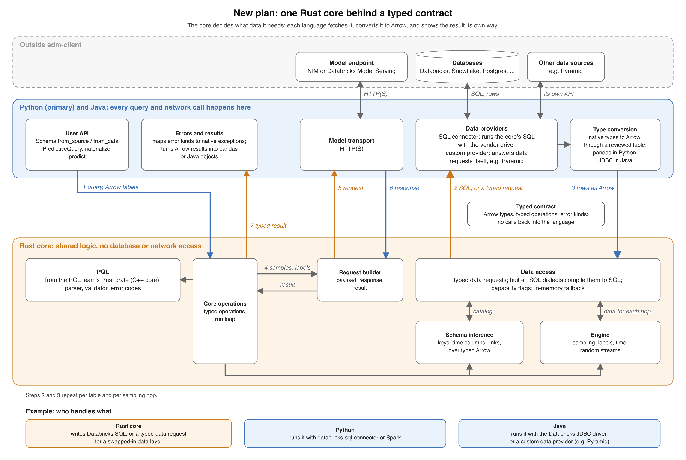
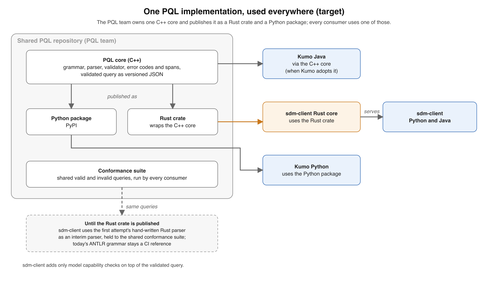
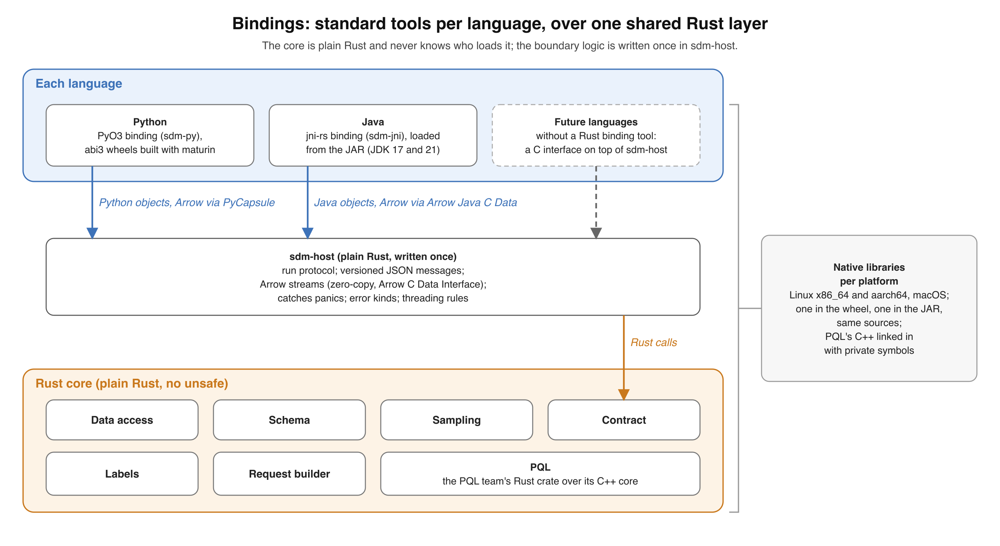
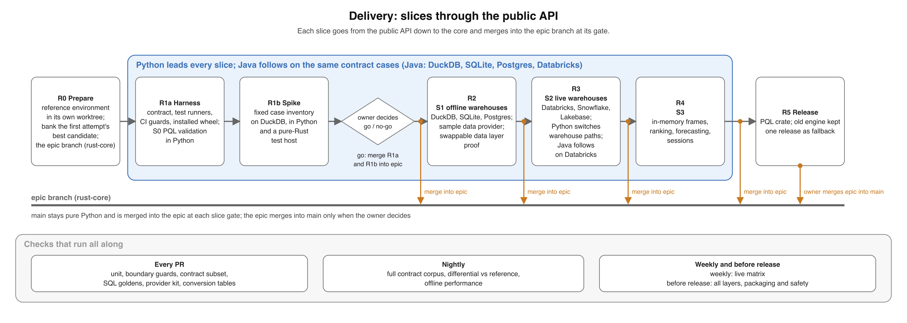

# Rust core migration: the new plan

**Status: approved by the owner; executed phase by phase, each with its own design doc and tracker.**
It replaces the first plan; the owner's decisions are in section 2.
The postmortem behind it is [learnings.md](learnings.md).

The goal is the same: one implementation of the client's logic shared by Python and Java, so the two can't drift.
What changes is where the line between the core and each language sits, how data access and PQL plug in, how the work is sliced and tested, and how the rules are enforced.
All of the work happens on an epic branch and stays experimental until the owner merges it into `main`.

The diagram above predates Phase 1 decision E18: no PQL-team crate or PQL C++ is part of the plan.

## 1. What changes from the original proposal

| Original proposal | New plan | Why |
|---|---|---|
| No API change, read as bit-for-bit answers | Behavior is defined by a public contract corpus and a register of kept Python quirks; anything else changes only by a named, approved entry | Bit-for-bit copying spread pandas' accidents through the core |
| Core receives query results as Arrow; frames described by the host | Core takes only a closed set of Arrow types; each language converts its own types through a reviewed table | The core grew six pandas column models and parsed dtype names |
| Core never calls into the host (stated) | Checked in CI: core crates can't depend on Python or Java bindings or name Python types, and a pure-Rust test host runs every contract case | The implementation called back into Python in 19 ways |
| SQL dialects inside the core | Data access is pluggable: the core emits typed data requests; SQL dialects are one built-in provider, and the layer can be swapped or a host can answer with its own provider (for example for Pyramid) | Agreed when the proposal was posted, then lost: the first attempt hard-coded the dialects |
| PQL: a hand-written port | One PQL implementation in this client: the hand-written Rust parser, completed and held to the reference's corpus, behind one adapter; the plan's earlier choice, the PQL team's C++ core through a Rust crate, is superseded (Phase 1 decision E18, approved by owner 2026-10-08) | Several PQL copies already drift |
| Port the client logic | Port defined algorithms; use Rust libraries for general data work; keep presentation and object behavior in the host | 27-29% of the Rust re-created libraries by hand |
| Python first, Java much later | Python leads every slice; Java runs the same contract cases from the start, so Python assumptions in the core surface early, but never holds Python back | Python assumptions surfaced only at the end |
| Module-by-module phases, merged at the end | Vertical slices through the public API, each merged into an epic branch at its gate; `main` stays pure Python until the owner merges the epic | Modules passed alone and broke together; nothing merged |

Unchanged: Rust, no I/O in the core, the run loop that asks the host to fetch data or call the model, official database drivers per language, and per-language packaging.

## 2. Decisions

The owner made these before any code:

1. **Python comes first.** Python is the main interface and matters most: no regressions for Python users, and Python's needs set the order of the work.
   Java is a second binding on the same core, built so the core stays language-neutral, never at Python's expense.
2. **Scope:** Python supports every backend it supports today (Databricks, Snowflake, Lakebase, Postgres, SQLite, DuckDB and in-memory frames, including files read from Amazon S3).
   Java starts with DuckDB, SQLite, Postgres and Databricks.
   Platforms: the client becomes one CPython `abi3` wheel per platform (3.10 and later, no sdist) for Linux x86_64 and aarch64 (`manylinux2014`, and `musllinux_1_2` if feasible; no PQL C++ is linked since Phase 1 decision E18, approved by owner 2026-10-08), macOS (10.12 x86_64, 11.0 arm64) and Windows x86_64, with `pyarrow>=10.0.1` and `pandas>=1.5` on `main` until the epic merges, and on the epic branch Python 3.10 to 3.14, `pandas>=2.2`, `numpy>=1.26` and `pyarrow>=14.0.1`, with Arrow through the PyCapsule interface only (Phase 1 decision E16, approved by owner 2026-10-08).
   Dropped by the owner: 32-bit, Windows on Arm, other architectures, PyPy, GraalPy and free-threaded CPython; Java natives are Linux x86_64 and aarch64 plus macOS, and only tested environments are claimed (`phase-0/support-matrix.md`, decisions G1 to G14).
3. **Regressions:** refusing an input the old Python client accepted is a regression, and so is dropping a platform or version Python supports today, unless the owner decides it explicitly.
   Java on Snowflake is not prioritized, so it is not held to this yet.
4. **Python quirks:** the register (section 5) follows common sense, with a small bias towards today's Python behavior but without catering to its accidents.
5. **Reference environment:** the reference branch `rust-core-reference` is `main` plus the minimum determinism fixes, never contains Rust, and is pushed to GitHub so it isn't lost; it is the reference the tests compare against.
   The fixes are only those needed for repeatable answers (seeded draws, stable ordering, independence from the hash seed), taken from the first attempt's `rust-core/p1-determinism` work, with no refusals and no other behavior changes; `phase-0/determinism-fixes.md` lists the selection.
   Each kept fix is first compared with unpatched Python, and any changed outcome is registered before the reference adopts it.
   It is installed in its own worktree and environment at `~/code/sdmc-reference`, with its Python, pandas, NumPy, PyArrow and torch versions recorded.
   Reference comparisons (L3, the full L2, the live and job matrices) run locally on the developer's machine, not in CI.
   It tracks `main`, which is safe because `main` never contains the Rust core before the epic merges; at each slice gate it is updated to the latest `main` and the full comparison rerun, and a new difference must trace to a deliberate commit on `main`.
   The original baseline is kept as an immutable tag `reference-baseline-<sha>`, and a guard fails if the reference ever loads the Rust core.
   Every test run records the reference commit and the identity of the installed artifact it used.
6. **PQL:** the PQL team owns one C++ core and publishes it as a Rust crate and a Python package; this client's core uses the Rust crate, with the hand-written parser as a stopgap (section 3).
   Superseded (Phase 1 decision E18, approved by owner 2026-10-08): the hand-written parser is permanent and owned by this team; no PQL-team crate is planned or waited on, and the PQL asks are retired.
7. **Data layer:** the data layer must be switchable: a team given access to this repository should be able to replace it, for example to work with Pyramid, without touching the rest of the core.
   A Pyramid provider itself is not in scope.
8. **Java:** the first Java consumer is a team using Pyramid, which brings its own data layer.
   Java gets basic support for the offline backends and Databricks, proven working on Databricks, and loads the core as a native library; WebAssembly is out, because its size limits are too restrictive.
9. **No calendar budget and no time estimates:** the work is paced by its gates, not by dates, and dates must not change the quality of the work.
10. **Ownership:** this team owns the core long term; that does not change how it is built.
11. **Epic branch:** an epic branch (`rust-core`) based on `main` holds all migration work.
    Each phase's work happens on its own branch off `rust-core` (for example `rust-core-phase-0`), pushed to GitHub so nothing is lost, and merges locally into `rust-core` once verified (section 9); there are no pull requests.
    Slices merge into the epic branch, never into `main`; `main` stays pure Python and keeps moving, and the epic branch is updated from `main` at each slice gate.
    Merging the epic into `main` is the owner's decision at the end; until then the work is experimental.
12. **People:** one developer works with agents.
    The independent reviewer is a fresh agent that did not implement the change; the owner is the only human approver.
    The owner approves by merging a verified phase or slice branch locally, by decisions recorded in the phase's decisions file, and by register entries marked `approved_by: owner`.
    An agent never approves its own exception or marks anything `approved_by: owner`.
13. **The first attempt:** its best candidate (commit `ab85a056`, tag `pm/2026-10-07/all-public-cases-pass`) is archived on GitHub as `archive/rust-core-attempt-1` (commit `3887762`, internal catalog and workspace names redacted), a source to port from that is never merged.

Still to agree with the PQL team: one PQL dialect, the versioned validated-query format, the conformance suite, platform builds, and when the Rust crate ships.
Phase 0 sends these asks and tracks them in `phase-0/pql-asks.md`; agreement is not a Phase 0 exit.
Retired (Phase 1 decision E18, approved by owner 2026-10-08): the asks stay a Phase 0 record and are not sent.

## 3. Architecture

### The contract

- **Inputs:** Arrow record batches restricted to a closed type set (below).
  Each language converts its native types through a reviewed table, without losing values or the metadata that matters (precision, scale, units, missing values, order).
  Inputs the old client supported stay supported unless the register says otherwise; anything else is refused by name.
  The core never sees a pandas dtype or a Java class.
- **Operations:** a versioned list of typed requests and responses (serde types, published as JSON Schema), not functions looked up by string name.
- **Runs:** the existing `Run`/`Step` loop, executed by one state machine in `sdm-core`.
  A data step carries either SQL (for SQL providers) or a typed data request (for custom providers), with ordered typed parameters and the Arrow schema it expects back, or a marker that the schema is being discovered.
  The host returns Arrow or a structured error.
- **Scalars:** the contract defines exact encodings for large integers, decimals, non-finite floats and temporal values, including precision, scale, units, overflow and rounding.
  Control messages round-trip them through Rust, Python and Java without floating-point conversion.
  There is no general Python scalar or object model.
- **Errors and warnings:** `{kind, code, message, fields, cause}` with a closed list of kinds, one channel for each, and warnings kept in order.
  Each language maps kinds to its own exception and warning classes.
  Codes are a closed, listed enum with a `retryable` flag, and each language's mapping is tested exhaustively, never reading message text (Phase 1 decision H6, approved by owner 2026-10-08).
- **Host facts:** clock, time zone, the tzdata version and similar facts are passed in explicitly, so tests can pin them; the core reads no locale.
- **State and memory:** typed, versioned values the host holds; Arrow buffers and runs have defined owners and release rules; no handles into host objects.

### The type set

| Kind | Arrow types |
|---|---|
| Integers | int8, int16, int32, int64, uint8, uint16, uint32, uint64 (kept as they are: today's payloads distinguish them) |
| Floats | float32, float64 |
| Decimals | decimal128, decimal256 |
| Text and bytes | utf8, binary (hosts convert `large_*` without loss, or refuse by name) |
| Time | date32, timestamp(ns or us, with or without zone), duration(ns or us), time64 (hosts cast `timestamp[s]` and `timestamp[ms]` to `us` without loss) |
| Nested | list, struct, map, dictionary of utf8; child types come from this set (hosts convert `large_list` and `fixed_size_list` without loss, or refuse by name) |
| Other | bool, null (all-null columns) |

Every accepted type is preserved or refused with a named error, never silently turned into nulls.
Arrow-to-Arrow admission into this set is one lossless table in `sdm-host`, shared by every language; a value the admitted type cannot hold is refused by name (Phase 1 decisions B-D6, confirmed by owner 2026-10-15, and E13, approved by owner 2026-10-08).
Phase 1b validates this set against its case inventory before it is final.

### What lives where

| Concern | Same in every language? | Where |
|---|---|---|
| PQL parsing, validation, error codes and spans | Yes | This client's parser, behind one adapter in `sdm-core` (Phase 1 decision E18, approved by owner 2026-10-08) |
| The run state machine, public operation dispatch, cancellation, model capability checks and profiles | Yes | `sdm-core` |
| Canonical schema, semantic inference over typed columns (keys, time column, links, semantic types), source-neutral view interpretation | Yes | `sdm-schema` |
| Catalog queries and view retrieval per source, typed data requests, SQL for each built-in dialect, provider capabilities, the in-memory fallback | Yes | `sdm-data` |
| Time rules, random streams, sampling plan, neighbor sampler, labels and aggregations | Yes | `sdm-engine`; labels over fetched Arrow, never compiled to SQL (Phase 1 decision E19, approved by owner 2026-10-08) |
| Materialization, session state, decomposition, payload limits, payload encoding, response decoding, result layout | Yes | `sdm-request` |
| Control-message codecs, native resource lifetime, panic containment, threading | Yes | `sdm-host` |
| Native types to Arrow (pandas dtypes, JDBC types) | No | Host, as a reviewed table |
| Running SQL on the user's connection, or answering data requests another way | No | Host data providers |
| Object behavior, exceptions, presentation (`to_pandas`, Java records) | No | Host |
| HTTP and authentication | No | Host |

Dependencies flow one way: bindings → `sdm-host` → `sdm-core` → domain crates → `sdm-contract`.
SQL fragments and provider matches never appear in `sdm-schema`, `sdm-engine` or `sdm-request`.

### Data access

The core asks for data through a small, fixed vocabulary of typed data requests.
The minimum every provider supports is two operations: describe the catalog, and scan a table with a column list and key and time-range filters.
Optional operations make common steps faster, and each provider declares which it supports: rows by key, rows in a time window, counts and minimum or maximum times, the latest neighbors per key, and a seeded sample of entities.
Before a run, the core picks pushdown or an in-memory fallback from the provider's declared capabilities.
Core-side sampling uses the registered random streams over a defined ordering of the same data, so it gives the same rows on every provider; a provider's own seeded sampling is repeatable only for that provider, and changing a backend's sampling needs a register entry.
A declared capability that fails is reported as an error, never silently replaced.

- **SQL providers:** the core compiles requests to SQL for each built-in dialect (Databricks, Snowflake, Postgres, SQLite, DuckDB), and the host runs it with the vendor's driver.
- **Custom providers:** the host receives the typed request and answers it its own way, for example by compiling it to a Pyramid query.
- **The provider contract** is versioned and defines null and duplicate keys, time units and zones, interval bounds, ordering of ties, typed errors (with retryability and driver codes), and complete results: scans page through every matching row, nothing is silently truncated, and the in-memory fallback has declared memory and transfer limits that fail loudly when exceeded.
- **Testing:** a provider conformance kit (a fixture dataset, multi-page results, limits, and expected answers including hand-checked ones) that every provider passes, the built-in SQL ones included, ending with a full prediction compared with the reference provider.

The data layer is one crate behind one documented interface, with the SQL providers as its reference implementation and the conformance kit as its acceptance test, so a team with access to this repository can swap it, or implement a provider in Java, without touching the rest of the core.
S1 proves this: a minimal non-SQL test provider passes the conformance kit, and the same prediction runs with an alternate data-layer implementation swapped in at the composition root, with no edits to domain crates.
A Pyramid provider is not part of this plan.

### PQL

Several separate PQL implementations exist today, and only two share tests.
The drift risk is less in the grammar than in the code around it (tree building, error handling, validators), so "defined once" means one implementation.

- **One implementation, this client's own (Phase 1 decision E18, approved by owner 2026-10-08):** the first attempt's hand-written Rust parser, ported in Phase 1 and completed there (the date-literal rules, the grammar quirks, fuzzing and a deep-query test), behind one adapter in `sdm-core`, so this client's Python and Java get PQL through the core.
  The crate is `sdm-pql`, its permanent name since Phase 1 task T1.28w (`sdm-pql-interim` before it).
- **One conformance suite** of valid and invalid queries with the reference's codes, spans and date readings, seeded with this client's 417 cases; today's ANTLR grammar stays in CI as a cross-check, through the reference observations and the corpus recorded on it.
- **The validated query** is a versioned format of this client's own, locked like the contract (Phase 1 decision E8).
- **Validity-affecting emulation** stays inside the parser crate, on a permanent allowlist; each addition needs the owner (Phase 1 decision H21).
- **This client keeps** the model capability checks on top of the validated query.
- **Superseded by E18:** the PQL team's C++ core published as a Rust crate, exercising its artifact behind the adapter, switching to it and deleting this parser in Phase 5, and the PQL asks (a C interface, static libraries per platform with private C++ symbols, matching releases, a shared validated-query format and conformance suite in their repository).
  The diagram above predates E18.

### Bindings

The diagram above predates Phase 1 decision E18: no PQL C++ is linked.

The core is plain Rust and doesn't know which language loads it.
Each language uses its standard binding tool, over one shared Rust layer:

- **`sdm-host`**, plain Rust, written once: encodes control messages as versioned JSON, hands data over as Arrow, owns native resource lifetimes, contains panics, and sets the threading rules; it schedules no domain work.
  Its calls take and give control messages as bytes with the attachments each names (Phase 1 decision E13, approved by owner 2026-10-08).
- **Python:** a thin PyO3 binding built with maturin as `abi3` wheels; it converts types, maps errors to Python classes, releases the GIL while the core runs, and passes Arrow through the standard PyCapsule interface without copying.
  On the epic branch that is the only path: the `pyarrow>=14.0.1` floor guarantees it, and the `_export_to_c` fallback for pyarrow older than 14 is dropped (Phase 1 decision E16, approved by owner 2026-10-08).
- **Java:** a thin `jni-rs` binding loaded from the JAR (JDK 17 and 21); it maps errors to Java classes and passes Arrow through Arrow Java's C Data module without copying.
- **Native safety:** first-party domain crates forbid `unsafe` Rust; only the binding and host adapters and external dependencies (Arrow; the PQL wrapper is superseded by Phase 1 decision E18, approved by owner 2026-10-08) contain native code, and they are tested explicitly.
  Semantic callbacks into the host are forbidden; Arrow release callbacks are allowed.
  C++ exceptions are translated inside the PQL wrapper (superseded by E18: no C++ is linked).
  A Rust panic is contained at each exported entry and invalidates its run.
  Aborts and memory corruption are tested in subprocesses, not claimed recoverable.
  Memory has one owner and an explicit release, and the threading model is written down.
- **Java runtime flags:** users run with `--enable-native-access` (Java warns without it from JDK 24 and will later refuse) and the flag Arrow Java needs; the Java consumer's environment must allow both.
- **PQL's C++ is linked into both native libraries** with its symbols kept private, so a Python process that also loads the PQL team's own package gets no clashes (superseded by Phase 1 decision E18, approved by owner 2026-10-08: no PQL C++ is linked).
- **Platforms and versions:** the owner decided the native coverage in Phase 0 (decision 2 and `phase-0/support-matrix.md`): Python wheels as above, and Java natives for Linux x86_64 and aarch64 plus macOS, to confirm with the Java consumer.
  pyarrow 8, as Databricks Runtime 14.3 ships, is upgraded by the `pyarrow>=10.0.1` floor (raised to 14.0.1 on the epic branch by Phase 1 decision E16).
  Dropping any further platform or version, or moving to `manylinux_2_28`, is an explicit owner decision, never a side effect.

Considered and not chosen: one C interface (`extern "C"`) with generic glue per language, because it means maintaining our own unsafe boundary where PyO3 and `jni-rs` already provide tested ones.
Other binding tools and running the core in a separate process are out of scope unless the owner changes it.

### Performance rules

Today a predict's wall time goes to warehouse round trips and the model call, and most client CPU goes to building the payload cell by cell in Python.
The core keeps the round trips as they are and should cut the CPU, as long as these rules hold:

- Data providers hand the driver's Arrow straight to the core, with no pandas round trip; drivers without Arrow build Arrow columns from rows directly.
- Tables cross zero-copy through the Arrow C Data Interface.
- JSON is only for small control messages, capped (for example at 64 KB); anything row-shaped travels as Arrow.
  Byte buffers and Arrow tables cross as attachments named by id (Phase 1 decision E2, approved by owner 2026-10-08), and so does every field whose size grows with user input, such as query text and schemas, so the cap never refuses an input (Phase 1 decision H5, approved by owner 2026-10-08).
- The host never parses or re-encodes the model request or response body; it passes the bytes on.
- Data requests are batched per hop, with no chatty per-row or per-entity steps.
- Object columns convert column-wise, never cell by cell.
- pandas 3's `large_string` and `timestamp[s]` are cast cheaply in the conversion table, not refused.

L7 (section 6) checks these.

### Crates

The names and boundaries below are the target ownership, not a reason to rename or rewrite everything before the first slice works.

| Crate | Holds | From today's tree |
|---|---|---|
| `sdm-contract` | Versioned types: the type set, operations, Step, request and response schemas, data requests and provider capabilities, errors and warnings, exact scalar encodings; no orchestration | New, folding in `protocol` |
| `pql` (from the PQL team) | Rust crate wrapping the C++ PQL core | Superseded by Phase 1 decision E18, approved by owner 2026-10-08: not planned; this client's parser stays |
| `sdm-data` | Catalog queries and view retrieval per source, typed data requests, SQL for each dialect, provider capabilities, the in-memory fallback | Keep the dialect backends behind a provider interface; drop the capture and render scaffolding |
| `sdm-schema` | Canonical schema, inference over Arrow, source-neutral metric and semantic view interpretation | Keep the engine; move catalog SQL to `sdm-data`; drop the pandas column models and dtype parsing; YAML through a library |
| `sdm-engine` | Modules for time (one calendar, the date parsing rules recorded in Phase 0, `DateOffset`, time zones), random streams, sampling (plan, neighbor sampler, graph store) and labels (kernels and windows) | Merges today's time, random, sampling and label code with one value model; time on a library, not a pandas date-inference clone; Arrow compute where answers allow |
| `sdm-request` | Modules for materialization, session state, decomposition, limits, payload encoding, response decoding and result layout | Keep the logic; drop the CPython sort and `json.dumps` size emulation |
| `sdm-core` | The single Run state machine, public operation dispatch, cancellation, model capability checks and profiles; the PQL parser (crate `sdm-pql`, `sdm-pql-interim` until Phase 1 task T1.28w renamed it; Phase 1 decision A3, confirmed by owner 2026-10-15, and Phase 1 decision E18, approved by owner 2026-10-08) behind one adapter | Rewrite the host API; typed operations only; capability checks from today's `pql` crate |
| `sdm-testkit` | Contract runner, provider conformance kit, fixtures | Dev-only; nothing in the shipped crates |
| `sdm-host` | Control-message codecs, Arrow handoff, native resource lifetime, panic containment, threading; no domain scheduling | New, written once |
| `sdm-py`, `sdm-jni` | Thin PyO3 and `jni-rs` bindings over `sdm-host`: convert types, map errors, release the GIL | Rewrite `sdm-py` much slimmer; new `sdm-jni` |

Today's `wire` crate is generated from the model API; `sdm-request` uses it, and there is no second hand-written wire model.

### Dependencies

| Need | Choice |
|---|---|
| Columnar data and kernels | `arrow` crates, including `arrow-cast`, `arrow-ord`, `arrow-arith`, `arrow-select`, `arrow-row` and `arrow-ipc` |
| Decimals and big integers | Arrow's decimal types and `arrow-buffer`'s `i256`, under the contract's exact-encoding policy |
| PQL parsing | This client's own Rust parser, no C++ (Phase 1 decision E18, approved by owner 2026-10-08; the PQL team's crate over its C++ core is superseded) |
| Dates, times, zones | `jiff`, with the host's ordered zone lookup roots and a bundled fallback, the source and version recorded per zone; `chrono` only as Arrow's transitive dependency and `chrono-tz` banned (Phase 1 decision A7, confirmed by owner 2026-10-15): it met DT-1 and DT-2 on every T0.6 zone and `DateOffset` answer, where `chrono-tz` failed. Instants past `jiff`'s range use civil arithmetic and are never refused for that reason (Phase 1 decision E6, approved by owner 2026-10-08). Inside the core, one instant and one span type in nanoseconds, columns kept as Arrow arrays, conversions checked (Phase 1 decision F3, approved by owner 2026-10-08) |
| YAML (metric and semantic views) | A maintained YAML 1.2 crate such as `saphyr` or `yaml-rust2` (not the archived `serde_yaml`); behavior differences go through the register |
| JSON | `serde`, `serde_json` |
| Error types | `thiserror`; no `anyhow` in core crates |
| Logging | `tracing`, bridged to Python `logging` by `pyo3-log` with the GIL released during core calls and a deadlock regression test (Phase 1 decision H8, approved by owner 2026-10-08), and to SLF4J, decided in the Java phase |
| Output order | `indexmap` or `BTreeMap` for anything that affects output order; `HashMap` iteration in outputs is banned through clippy's `disallowed_types` |
| Encoding and hashing | `base64`, `regex` and `sha2` where needed |
| Bindings | `pyo3` with `maturin` (abi3 wheels); `jni` (`jni-rs`); the Arrow C Data Interface in `arrow`, `pyarrow` and Arrow Java |
| Dataframe engine | Decided at Phase 2 entry: compare plain Arrow kernels with DataFusion on one label aggregation and one sampling join; correct answers are required, then weigh hand-written code, maintenance, speed, binary size and JNI loading; record the results (Polars is out: it uses its own Arrow implementation, not arrow-rs) |

**Policy:** `Cargo.lock` is committed and the toolchain is pinned; the pinned toolchain is the minimum supported Rust version.
`cargo-deny` checks advisories, licenses, bans and sources in L0, starting from the first attempt's `deny.toml` and toolchain file.
The wheel and JAR ship third-party notices, including for statically linked C++.
Dependency updates are reviewed changes made only at slice gates, with `arrow`, `pyo3` and `jni` updated together (today Arrow 58, `pyo3` 0.28 and `duckdb` 1.10506.0: Phase 1 decision B-D2, confirmed by owner 2026-10-15).

On the Python side, pandas and pyarrow stay as host dependencies, and the old engine is deleted on the epic branch in Phase 5.

## 4. Delivery: slices, not modules

| Slice | Public path | Languages |
|---|---|---|
| S0 | PQL validation | Python; Java follows |
| S1 | `Schema.from_source` → `materialize` → `predict` on DuckDB, SQLite and Postgres, offline, including ranking and forecasting; a minimal non-SQL test provider passes the conformance kit, and an alternate data layer swapped in at the composition root runs the same prediction with no domain edits | Python; Java follows |
| S2 | The same live on Databricks (with a metric view), Snowflake (with a semantic view) and Lakebase, including ranking and forecasting; the Databricks job matrix across runtimes; Python and Java agree on the same Databricks data (for Java, the questions without ranking or forecasting) | Python on all three; Java follows on Databricks |
| S3 | In-memory frames (including files read from Amazon S3) with their ranking and forecasting, link prediction, sessions, tabular requests | Python; Java as the owner adds scope |

Amazon S3 is unrelated to slice S3: `sdm_connectors.read` reading CSV or Parquet from `s3://` into pandas stays in the host, and its frames are covered as S3's in-memory frames.

A path is one public operation with one input mode on one backend (for example `predict` of a regression query on Snowflake), and one routing boundary chooses the old implementation or the core for each path.
Python switches a path on the epic branch only after its slice passes all its gates, live ones included: S0 (PQL validation), S1 and S2 paths switch together after S2, in Phase 3, so no call mixes old and new code, and S3 paths (frames, link prediction, sessions, tabular requests) switch after S3.
Phase 0 maps every Databricks job in the matrix to its paths, so S2 includes what its jobs need.
Within S2, Databricks comes first: its dialect, its provider and the AdventureWorks notebook (`examples/databricks/adventureworks_relational.ipynb`) running on the core, before Snowflake and Lakebase (Phase 1 decisions E27 and E31, approved by owner 2026-10-09); S1 and Phase 2 stay offline.
Each phase's branch merges locally into the epic branch once verified, never into `main`; the epic branch is updated from `main` at each gate, and merging it into `main` is the owner's decision at the end.
The old engine is deleted on the epic branch in Phase 5; the reference (decision 5) stays available after that.
Python sets the pace: a slice ships for Python when its Python gates pass, and Java follows on the same contract cases without holding it back.

## 5. The quirk register

The register is a machine-readable file at `docs/design/rust-core/register.yaml`.
Entries follow common sense, with a small bias towards today's Python behavior but without catering to its accidents.
Every entry names the old and new behavior, the affected inputs and contract case IDs (or issue or task IDs until Phase 1a creates case IDs), and who approved it: the independent reviewer approves entries, and an entry that refuses an input Python accepted needs the owner's approval (`approved_by: owner`), since that is a regression.

| Keep (part of the promise) | Drop (by recorded decision) |
|---|---|
| The random streams of the reference (numpy `RandomState` and `default_rng` where it uses them, `std::mt19937` for neighbor draws), pinned in Phase 0; keeping `default_rng` means porting its generator too; their vectors are never re-recorded to pass a dependency bump (Phase 1 decision F4, approved by owner 2026-10-08) | CPython's sort order around NaN scores (NaN ranks last) |
| Label arithmetic as today: float32 Kahan sums in row order, compared exactly, in Rust over fetched Arrow (Phase 1 decision E19, approved by owner 2026-10-08) | The size limit counted as `json.dumps` bytes (count the bytes sent) |
| `DateOffset` month-end rules | Python object protocols inside the core |
| PQL codes, spans and grammar quirks, as the reference gives them (Phase 1 decision E18, approved by owner 2026-10-08; no PQL-team agreement) | Errors as Python class paths |
| PQL date-literal rules, written down | Silent nulls or internal errors for types the old code mishandled |
| Today's public exception and warning classes and codes | Time zone rules ignored after 2037 |
| Text-column timestamp detection, under the reference pandas major (pandas 3: Phase 1 decision H1, approved by owner 2026-10-08) | |
| Integer widths in payloads | |
| Payload equality after parsing; SQL per database as reviewed golden files | |

Each needs its own decision, not a blanket rule: answers that differ between pandas 2 and 3 (pandas 1.5 left with Phase 1 decision E16, approved by owner 2026-10-08), SQL text changes, and YAML 1.1 values such as `yes` and `on`.
A difference only one runtime shows is a register entry naming that runtime, never an exclusion (Phase 1 decision H1, approved by owner 2026-10-08).

## 6. Testing

| Layer | What it checks | When |
|---|---|---|
| L0 Boundary guards | First-party domain crates forbid `unsafe` and their production dependency graph has no `pyo3`, `jni` or `arrow-pyarrow` (only the binding crates may use them); the run steps are only data and model steps (no requests for language behavior such as truthiness, sorting or dtype inference); a pure-Rust test host passes the contract subset; the contract's JSON Schema, run steps and the PQL validated-query format don't change without an owner-approved version bump (within a phase, each bump is a decisions row and the phase lands as one bump per merge into `rust-core`: Phase 1 decision H4, approved by owner 2026-10-08); `cargo-deny` and clippy's disallowed types | CI, on every push to `rust-core` and phase branches |
| L1 Unit and property tests | Algorithms in each crate, with every past mismatch seed; the shared PQL conformance suite; fuzzing of the PQL, YAML and contract-JSON decoders | CI, on every push to `rust-core` and phase branches |
| L2 Contract corpus | One shared list of cases, run in each language: a public call and its inputs in; ordered data requests, SQL and typed parameters, payload, result, warnings and error kind, code, details and cause out; row order compared only where the operation defines it; SQL traces compared only for SQL providers, and data-request traces checked against their own contract (against the reference, statement count and each statement's result gate, with order only under a total `ORDER BY`, while typed parameters and raw SQL text are diagnostic; the core's SQL is pinned by goldens: Phase 1 decision H9, approved by owner 2026-10-08); pickles written by the reference load in the new client, and new state carries a version; a coverage matrix is generated from the scope manifest (per language) over the case inventory for the current slice, with representative nested shapes and one generated refusal case per unsupported type, and an empty cell fails | CI on every push (subset, for feedback); local, before each slice gate (all) |
| L3 Differential generator | Random public-API inputs compared with the reference (decision 5), installed in its own environment, before and after the old code is deleted | Local, before each slice gate |
| L4 SQL goldens and provider kit | Reviewed SQL per database, executed on DuckDB, SQLite and Postgres; the local providers pass the conformance kit | CI, on every push to `rust-core` and phase branches |
| L5 Conversion tables | Each language's native-to-Arrow table, on pandas 2 and 3 (pandas 1.5 left with Phase 1 decision E16, approved by owner 2026-10-08), in CI cells named by runtime from `phase-0/support-matrix.md` (Phase 1 decision H1, approved by owner 2026-10-08); the same tables loaded into DuckDB, SQLite and Postgres reach the core with identical Arrow schemas, values, null masks, order and required metadata from Python's drivers and Java's JDBC, checked against expected values (large integers, decimal scale, timestamp units, nested nulls, list widths, dictionaries) | CI, on every push to `rust-core` and phase branches |
| L6 Live matrix | The scenarios in the scope manifest (per language) over the case inventory, on Databricks, Snowflake and Lakebase (Databricks' managed Postgres), plus the Databricks job matrix (one-time jobs across Databricks runtimes, compared with the reference's results); old versus new, and Python versus Java on the same data | Local, before the S2 slice gate and the switch, epic merge and release gates |
| L7 Performance | Offline, on recorded runs: query counts equal; CPU per scenario at most today's (aim well below; the first attempt measured about half), no scenario above 1.1 times; boundary overhead per in-memory run within a small fixed bound; the control-message size cap; zero-copy and "no pandas in providers" checks; import time and native library size within set limits; live: push-down median over at least five interleaved runs, caches off, within 10% on Databricks and Snowflake | Local: offline before each slice gate; live at switch and release gates only |
| L8 Packaging and safety | The real wheel and JAR install and load in clean containers (JDK 17 and 21, every platform in the declared support matrix); exported symbols and minimum system library versions checked (private C++ symbols and a process loading the PQL team's package as well are superseded by Phase 1 decision E18, approved by owner 2026-10-08); `sdm-host` under sanitizers; panic, C++ error, crash and leak tests in each language; HTTP retry, timeout and redaction tests | Focused checks whenever bindings or native dependencies change; the full platform matrix before the epic merges |

- **Scope manifests:** Python and Java each have a scope manifest (per language) over the case inventory.
  Python gates require the Python and pure-Rust checks; Java-only checks (such as JDBC conversion equality in L5) block only Java shipping, but a shared-core defect they expose blocks the affected path.
- **Ratchet:** the checks compare every case's full observed outcome with the last-green baseline (CI for the L2 subset, locally for the full corpus), so a changed answer, a new refusal or a removed case fails unless a register entry states that case's exact old and new outcome.
  The baseline is updated as part of each merge into the epic branch.
  This replaces choosing "neighboring cases" by hand.
  Each gate run uses the harness, runners, comparator, ratchet, guards and expectations of the checkpoint, the merge base with the phase branch (the last reviewed landing), not the candidate's; a protected path changes only when the independent review names it, an outcome only with an approved register entry, and a relaxation only with the owner; a field a runner cannot observe never passes (Phase 1 decision H2, approved by owner 2026-10-08).
- **Runners:** the reference is the oracle; the old client on the working branch is a smoke runner and the comparison base on runtimes other than the reference's (Phase 1 decisions H1 and H10, approved by owner 2026-10-08).
  The reference stays recorded on the owner's machine, where comparisons with it run; CI gates the platform-independent checks (Phase 1 decision H1, approved by owner 2026-10-08).
  About 40 seeded cases unseen by the implementer run once per phase gate for information, with a no-go threshold (Phase 1 decision H11, approved by owner 2026-10-08; its threshold approved as written by Phase 1 decision E66(e)).
- **Run time:** keep the CI checks fast and run slow ones locally before each gate; run time is something to optimize, never a reason to skip cases.
- **Test the tests:** before the L2 runners count for acceptance, show they fail on a corrupted expectation, a missing case, a skipped call and a missing native library.
- **Local first:** reproduce a failure from the installed package before spending a remote run on it; a failure that only happens remotely gets one bounded diagnostic run.
- **Retiring old tests:** the first attempt's internal-equivalence tests go once the L2 and L3 failure families they caught are covered, measured by seeding those failures and checking the new layers catch them.
  Algorithm unit tests stay.

## 7. Release gates

| Gate | Passes when |
|---|---|
| A change lands on a phase branch | L0, L1, L4, L5 and the L2 subset green in CI for Python and the pure-Rust host; the ratchet holds; a type or conversion fix comes with a public reproduction that failed first; focused L8 checks if bindings or native dependencies changed |
| Slice done (its branch merges locally into the epic branch) | The epic branch updated from `main` and the reference rerun on it locally; the full L2 for the slice green in Python (Java must be green for its own scope before it ships that slice); L3 on the agreed seed sets with no unexplained divergence; every difference has an approved register entry; for S2, L6 green for its scenarios; a fresh-agent review; the owner merges it locally |
| Python switch for a path (on the epic branch) | Its slice done; L6 green for it; the Databricks job matrix equal to the baseline; L7 within its limits, live timing included |
| Epic merges into `main` (the owner's decision) | Every slice done and switched; the full L8 platform matrix green; L6 and the job matrix green on the epic commit; the existing Python test suites green |
| Release | Every applicable layer green on the release commit, with the old engine deleted, including L6 and the job matrix; live test resources cleaned up |

**Release and versioning:**
- The native core ships inside the structured-data-models-client wheel, so users still install one package, unless a later decision says otherwise.
- The contract version is independent of the package version.
- Error codes and classes are promised; error message text is not.

## 8. Phases

| Phase | Work | Exit |
|---|---|---|
| Phase 0 | Create the epic branch `rust-core` and the phase branch `rust-core-phase-0`; extend `.github/workflows/ci.yml` to run the fast checks on pushes to `rust-core` and phase branches; create and push `rust-core-reference` (decision 5) with the fixes listed in `phase-0/determinism-fixes.md`, set up its worktree and environment at `~/code/sdmc-reference` with its guard, and tag the baseline `reference-baseline-<sha>`; compare each kept fix with unpatched Python and register changed outcomes; record today's platform and version support and the proposed wheel coverage; record the accepted text-date formats and inference rules; check `chrono` with `chrono-tz` against the date corpus; pin the random streams; map every Databricks job to its paths; choose the Phase 1b case inventory; send the PQL asks (section 3) and track them in `phase-0/pql-asks.md`; archive the first attempt (decision 13) | The reference branch, baseline tag and guard work; decisions recorded in `phase-0/decisions.md`; CI runs on `rust-core` and phase branches; the PQL asks drafted, with sending deferred by the owner (`phase-0/decisions.md` row 31; agreement is not a Phase 0 exit) |
| Phase 1a | `sdm-contract`, `sdm-testkit`, L0 guards, L2 runners for Python and the reference, the CI fast checks and the local gate checks; build and clean-install a real abi3 wheel in CI | S0 green in Python; the runners fail on seeded faults; the wheel installs and loads in a clean container |
| Phase 1b | Spike, fixed in scope: DuckDB `from_source` → `materialize` → `predict` → result through the new contract and the data provider interface, in Python and through the pure-Rust test host (which shows the contract needs nothing from Python), against a scripted model endpoint; the case inventory chosen in Phase 0 covers the hard seams: keys, decimal precision, nested values, empty and all-null data, and time inference; the text-date rules recorded in Phase 0 checked against the reference | Matches the reference on that inventory (inferred types, keys, time columns, data requests and SQL, payloads, results, warnings and refusals); the owner decides go or no-go (go: Phase 1a and Phase 1b merge into the epic branch and Java's S0 work starts; no-go: repair the first attempt in place, or stop) |
| Phase 2 | The dataframe-engine comparison at entry; S1, moving only the code S1 needs off the Python value model and onto the contract; the provider conformance kit, the minimal non-SQL test provider and the swapped data layer | Slice gate |
| Phase 3 | S2, Databricks first (its dialect, its provider and the AdventureWorks notebook, then the other warehouses; Phase 1 decision E31, approved by owner 2026-10-09), and the Python switch for S0, S1 and S2 paths, on the epic branch | Switch gate |
| Phase 4 | S3, moving the rest of the code as its paths need it | Slice gate and switch gate |
| Phase 5 | Delete the old engine on the epic branch (the switch to the PQL crate and deleting this client's parser are superseded by Phase 1 decision E18, approved by owner 2026-10-08); release candidate; the owner decides whether the epic merges into `main` | Epic merge gate, then release gate |

### Carried into Phase 2 from Phase 1's minor review findings

Phase 1's minor (P3) review findings that T1.36 did not fix, deferred by the owner on 2026-10-14 (the P3 backlog: the cheap set fixed in T1.36, the rest to these named rows), each with where it lives. Line numbers drift; the file is the anchor. FR P3-n is P3 n of the independent subagent's final whole-phase review at c49ee4f8, deferred the same way at T1.36. FR2 P3-n is P3 n of the same subagent's round 2 at 84d68cf5. FX-n is a gap found while fixing the final review's findings (T1.36 fixes 1 to 14), recorded the same way. FR2 P3-1, `float_nan`, comes first, and the go or no-go packet's Phase 2 list must lead with it: it is in the owner's Phase 2 class (E92), so not a defect, but it refuses `Schema.from_source` outright and real data is likely to hit it. Host error and warning wording, the other group a user can see, comes next.

| Phase 2 row | Item | What is left |
|---|---|---|
| **Lead item (first in the packet)** | FR2 P3-1 | **Any DOUBLE column holding a NaN in the rows the preview reads refuses `Schema.from_source` on the core**: `UNSUPPORTED_REQUEST`, rule `float_nan` (`sdm-schema/src/values.rs:107`), where the reference describes the source and materializes it (the independent subagent's round 2 at 84d68cf5, its P3-1). It is one rule of E92's owner-approved Phase 2 class (not-yet-refusals.md, row 4), so not a Phase 1 defect, but real data is likely to hit it (the survey's own note), and then a user's first call fails. Lift the rule, reading a NaN as the reference reads it |
| Host error and warning wording | G15 | A key or time-column refusal gives a generic message where the reference gave a worded one (`_rust/errors.py`; the P1B-12 follow-up) |
| | M4 | `materialize`'s `CONTEXT_BEFORE_DATA` and `ANCHOR_AFTER_DATA` in the reference's words (register P1B-75, Phase 1 decision E141) |
| | FX-1 | Pandas' `RuntimeWarning` when a double past float32's range is cast to float32: the reference raises it beside its `INVALID_REQUEST` at materialize, and the core does not, on a regression target and on a multiclass float target alike (it predates T1.36 fix 1; `contract/tests/test_t136_float_multiclass.py`'s `RUNTIME_WARNINGS` leaves it out of the core's comparison for `refuse.double-past-float32`) |
| | FX-4 | A constant-column warning showing a whole-table MIN of `'infinity'` (UTC session): the reference shows `9999-12-31 23:59:59.999999`, DuckDB's `fetchall` handing an infinity over as `datetime.max`, and the core shows `294247-01-10 04:00:54.775807+00`, DuckDB's own text, which T1.36 fix 13 uses for a value pyarrow cannot read. Text only, never gating; show an infinity as the reference does (`_rust/errors.py`; found by the independent subagent's re-check of fix 13, its P3-2) |
| Harness hygiene (tests and tooling) | C1 | T1.32b's cell-claim `[type]` seed claims float64 on a base with float64 features; it must claim a type no source column has (`contract/tests/test_refusal_map.py`) |
| | C2 | An acceptance test for a rust-host `old: none` ratchet entry stating stage and error (`tests/test_contract_ratchet.py`) |
| | C4 | Regression tests for `capture_check`'s streaming CLI order and the conftest grouping |
| | C5 | A test that `prepush.sh` runs the self-tests when `ci.yml` changes |
| | C7 | `test_refusal_map.py` seeds for the map writer's two fixes (`validate_query`; the own-probe core trimming) |
| | C8, C9(1), C9(2) | VARINT: Python writes it unencodable and Rust likely as binary, untested though both fail closed; `sdm-testkit`'s `values.rs` to fail closed on any field carrying `ARROW:extension:name`; the vacuous part-2c vector (an unchosen interval member) swapped to a `date64` member |
| | C11 | The probe subprocesses spill DuckDB temp files into their working directory (`contract/tools/*_probe.py`) |
| | C22 | `land.py verify`'s moved-from fallback has no self-tests and may accept an older green run; its "patches" wording (re-check against CI4 first) |
| | C28 | CI's skip step's `jq` should also require `.event == "push"`, as `land.py` does (`ci.yml`, `tests/test_ci_workflow.py`) |
| | U3 | `ratchet.semantic()` hard-codes the ungated parts instead of reading `compare-policy.yaml` |
| | U4 | The ratchet's `WITHDRAWN` check is a denylist ("approved by owner … (declined)" still counts) |
| | U13 | Contract versions collide across lanes; a renumbering script |
| | M1 | The attachment-decode guard misses a two-line `take_json` (`sdm-core` `dispatch.rs`), and as-built's T1.22 claim overstates it |
| | M2 | `sdm-request`'s dev-dependency enables `sdm-contract/test-ops` without `sdm-core/test-ops` (a multi-package build may fail) |
| | M5 | The timestamptz test sets only DuckDB's session zone, and CI sets no process `TZ` (`tests/test_the_materialize_route.py`, `ci.yml`) |
| | M9 | rust-host checks only a policy refusal's `code`, not `field`, `reason` or `prediction_as_answered` (`sdm-testkit` `t128b_predict_result.rs`) |
| | M10 | The Kawi vector passes on any mention in the register; tighten it to P1B-25 |
| | G2 | The nested probe counts any `]::X[2]` source as P1B-9 without checking `left_out` (`nested_schema_probe.py`) |
| | G4 | A diagnostic S0 case may name any owner-approved entry, not only PQL-1 and PQL-2 (`tests/test_contract_cases.py`) |
| | G5 | rust-host skips `validate_query` when a case also names `materialize` (`sdm-testkit` `host.rs`) |
| | G6 | No test pins the per-step `driver_class` reset (`_rust/run.py`) |
| | G10 | `prepush.sh`'s `git diff --name-only` follows renames; add `--no-renames` |
| | G12 | `coverage.py` reads `tables: []` as "all tables" |
| | G16, G17 | One shared `cell_type` vector file for `coverage.py` and `admission.rs`; a subject column per claim |
| | FX-2 | `contract/tests/test_t132d_empty_null_family.py`'s `test_the_answer_comparison_fails_closed` asserts `registered_case('empty.fact-table') == 'P1B-11'`, the first approved entry listing the case, which breaks when an earlier entry comes to list it (as T1.36 fix 7 broke the time family's twin assertion on DT-12, which the test author fixed in Python and Rust at f23d8cf7): assert P1B-11 among every approved entry listing the case. A test author's file |
| | FR P3-2 | The bridge freeze's coverage against the ledger: `SDMClient._send_body` (`client.py`) is ledgered but not in `COVERED`, and `_rust/codec.py`, `_rust/edits.py` and `_rust/errors.py` hold ledgered rules but are not in `WHOLE` (`scripts/rust_core/bridge_freeze.py`); freeze them, declare the new entries and re-baseline with `--write` |
| | FR P3-7 | The judging tools' weak points, none exploited in Phase 1: locked check 1b judges check 4's dbr17 clause only through CI's per-cell compare (`gate.sh`), so the packet cites CI's `contract-python (dbr17-pandas2)` job; diagnostic cases are outside checks 4 and 5; `ratchet.py`'s `check_reference` takes a reference line's change under any approved entry naming the case; a non-inventory acceptance case can be demoted under a reviewer-only entry |
| Case corpus and loader | C6 | The large-buffer `SET` form must require `=` or `TO` (`run_python.py` and `sdm-testkit`'s case loader) |
| | C18 | The zone static check should also cover TIMESTAMPTZ cases with no zone set, and zone settings in `contract/bases.yaml` |
| | M7 | A cross-host case for the "key on the time column" rule (only a unit test holds it) |
| | C16 (rest) | `contract/type-set-vectors.json`'s witnesses `timestamp.us.utc` and `timestamp.us.named-zone`, and its `duckdb_arrow_by_setting` zoned row, set the zone per connection, so a cursor takes the recorder's zone: re-record with `SET GLOBAL TimeZone`, then take the two from `tests/test_contract_cases.py`'s pending list (T1.36 fixed the empty-null and nested vectors) |
| CI | U14 | Rerun a failed job once on a registry's `toomanyrequests` (likely closed by the self-hosted CI images) |
| Core and data hygiene | U1 | Day-first warnings from earlier literals are dropped when the query is then refused (`sdm-core` `pql.rs`; the code half, as-built records the behavior) |
| | U12 | Duplicate `integer()` helpers (`sdm-core` `compose.rs`, `sdm-data` `duckdb.rs`) |
| | M3 | `schema_check`'s full keyword walk (its wording was fixed at T1.36) |
| | M6 | `check_memo` does not require `indexes_checked` when bounds exist (`sdm-core` `materialize.rs`) |
| | FX-3 | The owner's answer to register P1B-80 (2026-10-15, item 45, E152): the named refusal kept for Phase 1, matching the reference a Phase 2 item. Match the reference for one VARCHAR or BLOB value over 2 GiB under `arrow_large_buffer_size`, keeping it in a large form through describe (the BLOB left out unread, the VARCHAR described, then refused by name at materialize, where the reference runs out of memory) |
| | FR P3-8 | The key cast's edge cases, each with a vector and a note under register P1B-34 or P1B-35: `Decimal('1E-7')` into a text key; a `timedelta` or `time` into an integer key; a float of 2**63 into int64 (the reference saturates); an `arrow.bool8` tag under run-end encoding dropped (`sdm-host` `admission.rs`; DuckDB never writes one) |
| Differential tools and the live benchmark | M8 | The differential no longer compares `_by_time` seeds outside `AFTER_THE_LABELS` (`contract/tools/differential.py`) |
| | G8 | The live benchmark's `different` comparison does not fail the run (`scripts/live/real_data_benchmark.py`); fix before any rerun |

## 9. Process rules

| Rule | How it's enforced |
|---|---|
| The epic branch holds the only candidate; work on the next slice starts only after this slice's gate passes; independent tasks within a slice may run in parallel | CI fast checks on the epic and phase branches; the phase's tracker lists open branches (Phase 1 decision E53, approved by owner 2026-10-10: no status page) |
| Each phase's work happens on its own branch off `rust-core` (for example `rust-core-phase-0`), pushed to GitHub so nothing is lost; a candidate that passes its checks is pushed before more work builds on it; phase branches never merge into `main`; the epic branch is updated from `main` at each slice gate | Once verified (CI fast checks, local gate checks, a fresh-agent review), the phase or slice branch is merged locally into `rust-core` and `rust-core` is pushed; there are no pull requests |
| Acceptance is what CI and the local gate checks run, plus one independent reviewer per change (a fresh agent that did not implement it), the owner's decisions, and one independent release audit of the existing evidence | The owner's approval is the local merge of a verified phase or slice branch, plus decisions in `phase-N/decisions.md` and register entries marked `approved_by: owner` |
| A change iterates until its reviewers approve, and a check failing twice the same way changes method and goes to the owner (Phase 1 decision E29, approved by owner 2026-10-09, replacing "at most two review rounds; a third goes to the owner"); an independent reviewer checks code and behavior, not prose | Recorded in the phase's tracker |
| A phase's acceptance checks are locked before implementation; each change states what and why; a third change to a phase's locked acceptance checks goes to the owner | Locked files change only with the owner's approval |
| Approval by meaning: one decision approves all the files it explains | Register entries and owner decisions; no per-file hashes |
| Stop rules (below) are lifted only by the owner, never by delegation; on a stop, implementation and live runs pause and the evidence is reported; each phase names owner check-ins, with a five-line report, past which work waits for the owner's answer (Phase 1 decision H12, approved by owner 2026-10-08) | The owner's decision in `phase-N/decisions.md`; an agent never approves its own exception or marks anything `approved_by: owner` |
| The phase's tracker shows the candidate commit, gates passed, open failures and decisions needed (Phase 1 decision E53, approved by owner 2026-10-10: the generated status page is not built) | CI runs and git, cited by each tracker row |
| Anything that changes behavior or scope goes to the owner straight away | Register entries and the phase's tracker |
| New acceptance infrastructure beyond the agreed test runner needs the owner's approval | Listed in the phase's tracker |
| Each phase has `docs/design/rust-core/phase-N/design.md` and `tracker.md` on its phase branch | Created with the phase branch |

Where things live: the reference worktree at `~/code/sdmc-reference`; the baseline tag `reference-baseline-<sha>`; owner decisions in `phase-N/decisions.md`; the register at `docs/design/rust-core/register.yaml`, whose entries may cite issue or task IDs until contract case IDs exist in Phase 1a.

**Stop rules:**
- a phase that keeps finding new work instead of closing its exit checks stops for a re-plan with concrete cuts;
- a check failing twice the same way changes method, never adds a phase;
- after two fix rounds on the same divergence, the owner chooses between repairing it, deferring the slice with the old path unchanged, and approving a named behavior change; nothing becomes an accepted refusal automatically;
- three live failures for non-product reasons stop live work;
- if S1 can't go green for Python, the owner chooses the next step;
- while a blocking question waits for the owner, work narrows to the current slice; silence never authorizes going on.

## 10. Risks

| Risk | Mitigation |
|---|---|
| The Java consumer's environment can't load a native library | Check it with the consumer before Java packaging; if it can't, the owner decides Java's scope |
| The PQL Rust crate isn't ready when needed | Retired by Phase 1 decision E18, approved by owner 2026-10-08: this client's parser is permanent, held to the conformance suite |
| The C++ PQL core complicates every build and can crash across the boundary | Retired by Phase 1 decision E18, approved by owner 2026-10-08: no PQL C++ is linked |
| A native library builds but doesn't load on some platform | Phase 1a installs a real wheel; L8 installs the real artifacts in clean containers whenever native code changes, and for every platform before the epic merges |
| Native wheels silently drop a platform or version Python supports today | Phase 0 records today's support; any drop is an explicit owner decision |
| The Java consumer's environment disallows the needed runtime flags | Confirm `--enable-native-access` and Arrow Java's flag with the consumer before Java packaging |
| A team swapping the data layer for Pyramid finds the interface insufficient | The interface is documented, a minimal non-SQL provider and a swapped data layer prove it in S1, and the conformance kit defines what a replacement must do |
| Host conversion tables drift between Python and Java | L5 checks both languages convert the same table to the same Arrow types |
| The new client is slower than today's | The performance rules in section 3, checked offline by L7 |
| Process grows faster than product again | Rules enforced by CI and the owner, not by the executor; new acceptance infrastructure needs approval |
