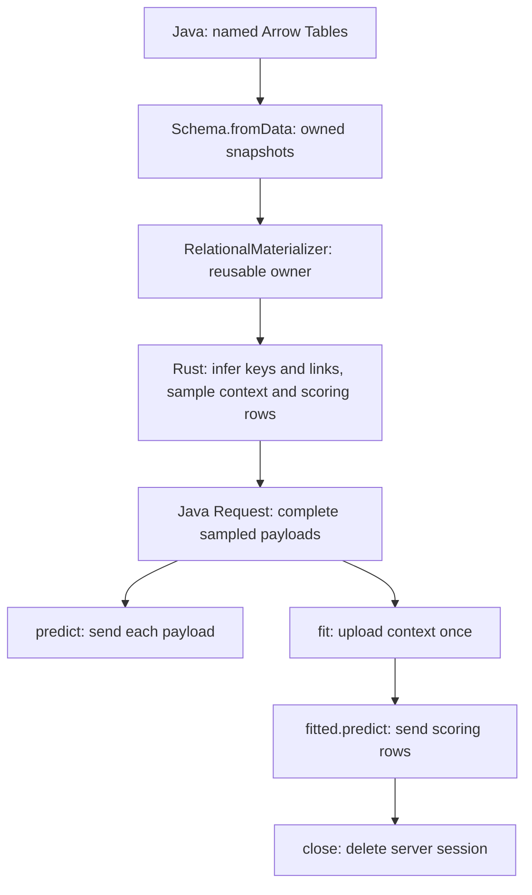

<!-- SPDX-FileCopyrightText: Copyright (c) 2026, NVIDIA CORPORATION & AFFILIATES. -->
<!-- All rights reserved. -->
<!-- SPDX-License-Identifier: Apache-2.0 -->

# Java in-memory Relational

Java now uses the same Rust sampler and session rules as Python.
Warehouse SQL and providers are unchanged.



| Boundary | Responsibility |
|---|---|
| Java | Arrow snapshots, caller options, HTTP, resource lifetime |
| Rust | Schema meaning, graph, sampling and RNG, payloads, multipart results, session checks |
| Model server | Prediction and uploaded session context |

```java
Schema schema = Schema.fromData(Map.of("users", users, "orders", orders));
try (RelationalMaterializer sampler = new RelationalMaterializer(schema)) {
  Request request = PredictiveQuery.parse("PREDICT users.value FOR EACH users.user_id")
      .materialize(sampler, MaterializeOptions.builder().indices(1L, 2L).build());
  PredictionResult result = client.predict(request, SdmClient.KUMO_RELATIONAL);
  try (FittedModel fitted = client.fit(request, SdmClient.KUMO_RELATIONAL)) {
    PredictionResult repeated = fitted.predict(request);
  }
}
```

For one call, `materialize(schema, options.model(KUMO_RELATIONAL))` uses a temporary sampler.
Without explicit model selection, in-memory `materialize(schema, options)` retains the existing single-table Tabular default.
Existing schema key, time-column and relationship setters apply before constructing the sampler.

**Ownership:** callers can mutate or close input Arrow tables after `Schema.fromData`.
A reused sampler retains its graph and continuing RNG; its calls and close are serialized.
Requests remain usable after the sampler closes.
This uses owned IPC snapshots, not zero-copy ingestion.

**Coverage:** static and temporal scalar targets, temporal links, candidate ranking, forecasts, repeated predictions and fitted sessions.
Sessions pin one question; rewritten ranking/forecast requests use ordinary prediction.
A failed later model call preserves completed rows through `exception.answered(allocator)`; close that Arrow reader.
Failed server deletion remains retryable.

Arrow dictionaries and dates normalize in Rust without Python callbacks.
Relational decimals use exact Decimal128 storage (up to 38 digits); integral decimal keys normalize to signed 64-bit storage when the inferred type permits it.
Out-of-range conversions fail explicitly instead of silently replacing values with null or rounding keys.

Validation: two independent architecture/code reviews, JDK21 full suite (274 tests, zero failures, 13 environment-gated skips), and JDK17 focused sampling/session/ownership tests (16 passing).
Rust core, schema and contract suites passed, including exact Arrow admission and attachment inventories.
HTTP lifecycle tests use a local model stub; this change does not claim a new live Java Relational endpoint comparison.

## Warehouse sessions

A request already materialized from a warehouse uses the same `client.fit(request, KUMO_RELATIONAL)` and fitted `predict`/`close` calls.
Java forwards the existing sampled payload; Rust owns holdout filtering, pinned-question checks, scoring batches and cleanup state.
Fit and fitted prediction do not reconnect to the warehouse or resample data.
Databricks Model Serving transport still refuses sessions; a session-capable model HTTP endpoint is required.
No warehouse SQL or provider implementation changes are needed.
Two independent reviews approved this extension; ten DuckDB/SQLite HTTP lifecycle tests passed, including scoring after closing the JDBC connection, temporal windows, holdout filtering, partial results and retryable cleanup.
