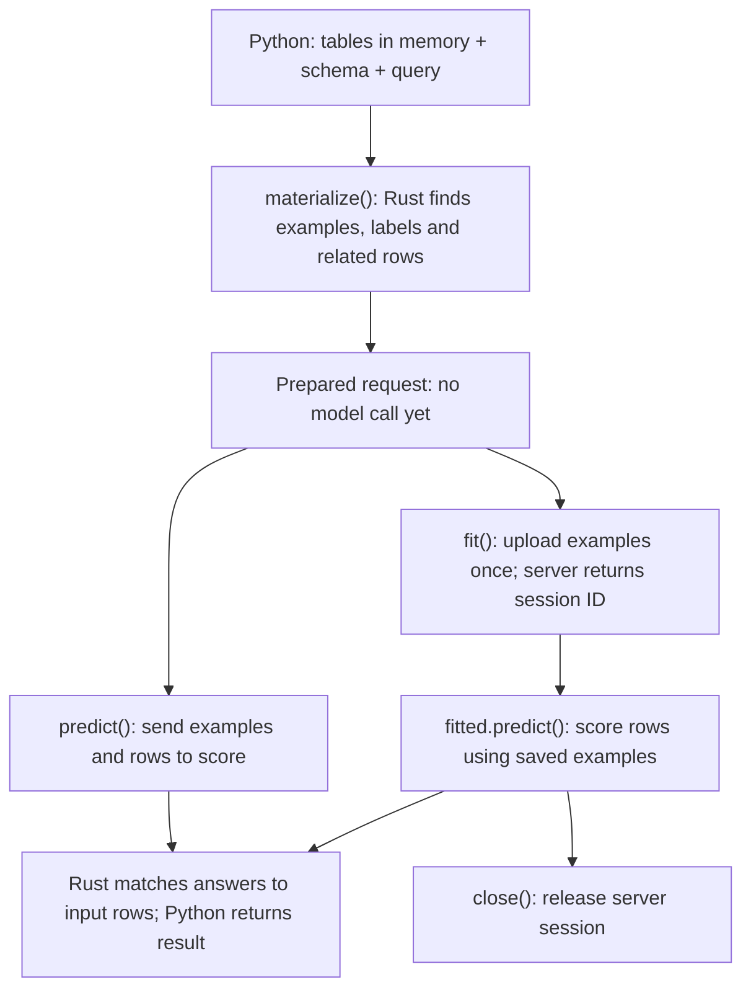

<!-- SPDX-FileCopyrightText: Copyright (c) 2026, NVIDIA CORPORATION & AFFILIATES. -->
<!-- All rights reserved. -->
<!-- SPDX-License-Identifier: Apache-2.0 -->

# In-memory Relational: what happens where

**Goal:** use Rust to prepare related tables for prediction, keeping the existing Python API.
Database push-down sampling stays unchanged.

## The user journey

`fit()` does not train the model.
Sessions require an endpoint that supports them; this design reuses the existing session API.
For each network call, Rust prepares/checks model data and Python performs HTTP and presents the result.
This work primarily replaces the in-memory preparation behind `materialize()`; it does not rebuild warehouse sessions.

## What changes inside materialize()

| Today | Proposed |
|---|---|
| Python and the legacy engine build the graph and sample related rows | Python supplies typed columns; Rust builds the graph and samples related rows |
| Sampling runs through the old engine | Rust keeps the graph and sampling state together until their owner is released |

Python keeps DataFrames and handles their conversion.
Rust owns row selection, labels, relationship traversal and sampling decisions.
It does not ask Python which neighbor to choose.
Prepared intermediate data stays in Rust instead of repeatedly moving to Python and back.

## Four rules

1. **Correct examples:** preserve row identities, relationship order, time cutoffs and held-out/target exclusions.
2. **Correct randomness:** each materializer/model keeps its own continuing random state, including after failures; concurrent access is serialized.
3. **Clear memory ownership:** define when input is snapshotted; protect it from later frame mutation without copying at every step, and release it with its owner.
4. **No warehouse changes:** reuse existing prediction machinery without modifying SQL sampling or provider fallback.

## Parity means correct behavior, not copying bugs

Preserve supported user workflows and meaningful results, not every incidental behavior of the old implementation.
When a difference appears, reproduce it through the public API and decide whether it is a regression or a confirmed old-client bug.
For a bug, document the intended behavior and add a regression check for the improved result; do not stall the migration trying to recreate it.
Faster execution and lower memory use are welcome when correctness is preserved and measurements support the claim.
Do not weaken temporal cutoffs, target exclusions or row attribution just to make comparisons pass.

## Delivery

First connect one two-table `materialize → predict` journey, then complete remaining task/type cases and session integration checks.
Finish with old/new correctness checks, memory/time measurements and independent reviews.
The first example is a checkpoint, not completion.

The archived implementation has reusable graph ownership code, but it is absent from the current branch and must be reviewed before reuse.
The earlier independent review approved this direction, especially ownership and random-state rules; this document simplifies that reviewed design.

Java Tabular can proceed separately: see [its short plan](java-tabular.md).
