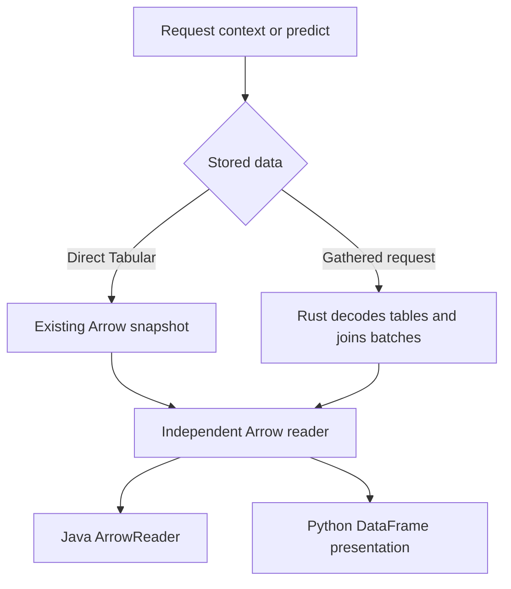

<!-- SPDX-FileCopyrightText: Copyright (c) 2026, NVIDIA CORPORATION & AFFILIATES. -->
<!-- All rights reserved. -->
<!-- SPDX-License-Identifier: Apache-2.0 -->

# Read the data held by a request

Python exposes `request.context` and `request.predict`, each with an instance table and named related tables.
Java currently exposes payloads and row counts, but lacks this complete view.
Add the view in Java and move Python's gathered-data decoding and ID adjustment into the same Rust operation.
Prediction payloads stay byte-for-byte unchanged; inspection never samples or queries a source.

## Public boundary

| Owner | Responsibility |
|---|---|
| Java `RequestSplit` | `request.context()` / `predict()` return a lightweight immutable view; `read(allocator)`, `relatedTables()`, `readRelated(name, allocator)` expose its data |
| Python `Split` | Keep the existing public instance/related DataFrames; gathered properties call the shared operation, then convert Arrow for presentation |
| Rust `sdm-request::split` | Decode the existing wire format, combine batches, preserve instance-to-related links, and produce Arrow |
| Both hosts | Keep existing snapshots alive; callers close their own readers; reading never changes the request |

Direct Tabular keeps its existing Arrow types and snapshot reader.
Gathered inspection holds no cached second copy of the request's rows.
Reading one related table still considers every table when calculating batch ID offsets.

## One internal operation

`ReadRequestSplit { payloads: [attachment IDs], half: context | predict, selection: names | instance | related(name) | all }` consumes the existing UTF-8 payload attachments.
It returns `{ op: "request_split", instance: optional Arrow ID, related_tables: [{ name, data: optional Arrow ID }] }`.
Python selects `all` to decode each half in one call; Java selects only the table its caller reads.
The names-only selection returns no Arrow data; a selected table does not allocate unrelated output tables.
An unknown related name is `INVALID_REQUEST`; a declared but absent table or half returns its typed empty table.
Core dispatch owns attachment handling; the inverse decoder belongs beside the existing payload writer in `sdm-request`.
There is no existing general inverse decoder to reuse: use the writer's seven-type vocabulary, not a second general schema inference system.

| Declared wire dtype | Inspected Arrow value |
|---|---|
| `int64` | Exact signed 64-bit integer, including the writer's decimal strings above 2^53 |
| `float32`, `float64` | The declared finite floating type |
| `string`, `stringlist` | Text or lists of text; never parse declared text as numbers |
| `bool` | Boolean |
| `timestamp[us]` | Microseconds with no timezone, matching the wire declaration; decode the writer's ISO timestamp representation |

Nulls remain null, including all-null columns and nullable string-list elements; empty tables retain their declared types.
Use encoded headers for column order and first appearance for related-table order.
Across batches, take the column union and fill absent columns with null; repeated columns must declare the same dtype.
Missing/unknown dtypes, contradictory cells, malformed rows, or conflicting declarations fail explicitly rather than becoming null or guessed types.
Categorical meaning does not change a column's declared storage type.

## Preserve links when joining batches

For each envelope, compute the lowest and highest numeric `instance_id` across its instance table and **all** related tables.
Booleans and declared text IDs do not participate; finite fractional IDs use floor/ceiling for these bounds.
The first envelope with numeric IDs is unchanged; an envelope with none reserves no IDs.
For each later envelope, use `shift = next_id - lowest_id` for every numeric instance reference.
After each numbered envelope, set `next_id = max(previous_next_id + instance_row_count, highest_id + shift + 1)`, including the first envelope with shift zero.
Use checked arithmetic: overflow or an unrepresentable adjusted ID is an explicit error, never wrapping or rounding into another instance.

This intentionally improves inspection: declared integers encoded as strings now become exact integers and participate in rebasing; declared text IDs remain text.
Declared timestamps become typed times instead of inferred strings.
Both languages use these same rules, replacing Python's duplicate `_split_from` policy.
These are inspection-only dtype improvements, not changes to materialization or prediction.

## Acceptance

Verify direct and gathered instance/related views, multiple batches and request parts, negative/fractional IDs, numeric strings above 2^53, text IDs, empty/all-null data, timestamp precision, contradictory metadata and checked overflow.
Compare ordinary gathered values/links with the frozen client and explicitly assert the documented dtype improvements.
Read after closing source connections; close readers independently; predict and persist the original request afterward with identical payload bytes.
Review this type/attachment contract before implementation; root owns the shared contract version and generated schema update.
