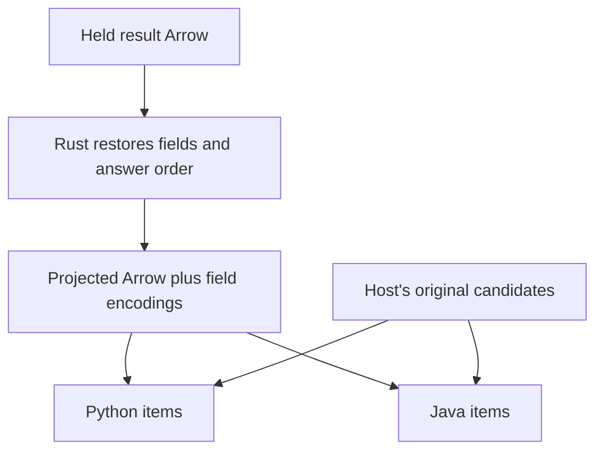

<!-- SPDX-FileCopyrightText: Copyright (c) 2026, NVIDIA CORPORATION & AFFILIATES. -->
<!-- All rights reserved. -->
<!-- SPDX-License-Identifier: Apache-2.0 -->

# Read semantic prediction items

Java's `read(allocator)` exposes the core's Arrow transport layout.
Python's `items` also restores semantic outputs: ranking predictions contain candidate values, not position numbers or JSON text.
Add `Java PredictionResult.items()` and share that restoration in Rust; keep the existing Arrow reader compatible.

| Boundary | Work |
|---|---|
| Rust | Reuse normalized-result decoding; restore answer order, select ranking outputs, and emit explicit original-candidate positions |
| Hosts | Decode declared representations, look up candidate positions, instantiate immutable items; no ranking or output-selection policy |
| Java `read()` | Keep its existing raw Arrow layout; no breaking change |

`ReadResultItems { input: BytesID, table: ArrowID }` consumes the existing `ResultPart` descriptor and normalized Arrow result.
It returns `{ op: "result_items", segments: [{ table: ArrowID, fields: [{ name, encoding }] }] }`.
Segments split only at regular/ranking transitions, preserving valid mixed-task merges; an empty result returns one typed empty segment.
The output rows follow semantic answer order; descriptors are unique and exhaustive.

| Encoding | Arrow storage / host conversion |
|---|---|
| `native` | Existing typed Arrow values; Arrow maps become mappings |
| `value` | UTF-8 holding existing `PrimitiveOption`: exact integer digits, tagged scalars including non-finite floats, arrays and objects |
| `mapping`, `mappings` | The same lossless carrier; interpret one mapping or a list of mappings, including non-text keys encoded as pairs |
| `candidate_list` | List of original positions; look up the host's immutable candidate values |
| `candidate_rankings` | List of `{position, score}` structs; look up each candidate and retain its score |

Keep item metadata, explanations and quantiles distinct from result metadata.
Nulls, wide integers and non-finite values retain their meanings; there is no new heterogeneous Arrow inference system or full-table JSON mirror.
Hosts reject missing candidate positions explicitly.
Java merges retain candidate-owner ranges in answer order, preserving distinct candidate lists without changing shared merge policy or copying rows.
Python retains original caller objects through its existing position map.

Verify regular, classification, forecast and both ranking forms; requested output subsets; empty/null data; exact scalar rescue; arbitrary mapping keys; merges with different candidate lists; and prediction evidence unchanged.
The current live records remain immutable evidence; corrected semantic observations use the next reviewed artifact.
