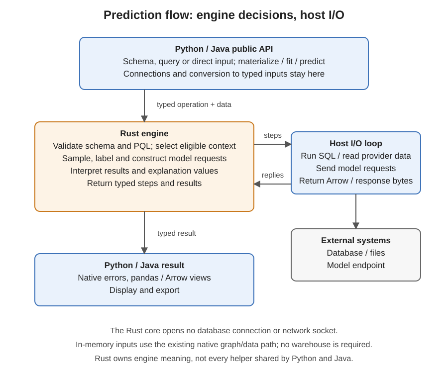
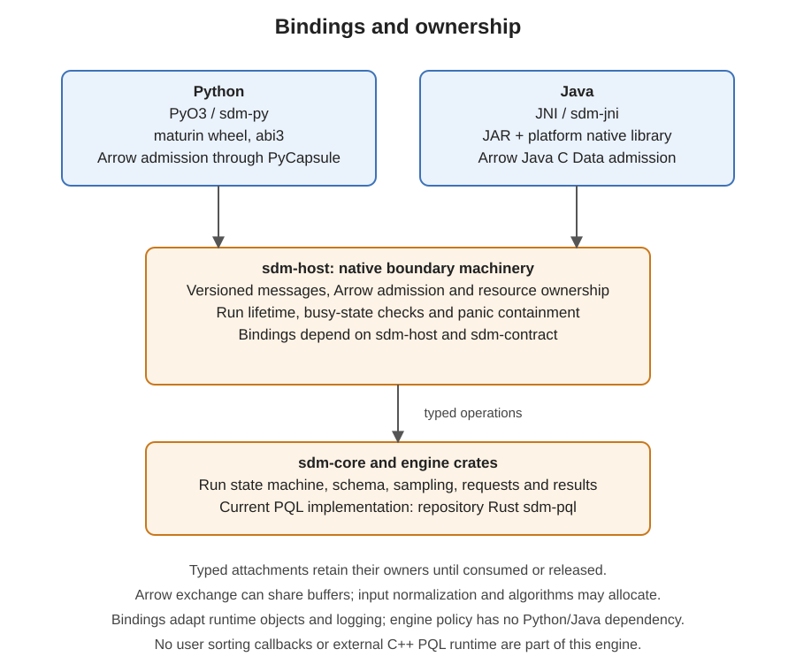

<!-- SPDX-FileCopyrightText: Copyright (c) 2026, NVIDIA CORPORATION & AFFILIATES. -->
<!-- All rights reserved. -->
<!-- SPDX-License-Identifier: Apache-2.0 -->

# Engine boundaries and behavior to preserve

The Rust core decides what a prediction means: schema/query semantics, eligible data, sampling, labels, request construction and result interpretation.
Python/Java own user-facing objects, connections, transport, conversions, display and file/cache operations.
A helper does not belong in Rust merely because two languages use it.
The current [crate map](../../rust/README.md) and [change guide](change-guide.md) describe implementation ownership and required review.

Regenerate these SVGs with `python docs/development/images/make_diagrams.py`.
The diagrams describe current code, not a planned external PQL library.
They summarize ownership; Arrow admission and logging may invoke host-runtime facilities, but engine semantics never depend on user sorting callbacks.

## Capability contracts

These are enduring rules extracted from completed implementation plans, not a second API inventory.
The [compatibility manifest](../../tests/parity/manifest.json) maps exact Python/Java symbols, applicability, types and assertion links; the implementation docstrings define full signatures.

| Capability | Owner and rule |
|---|---|
| Schema inference/edits | Rust validates atomic edits and inferred/declared provenance. Explicitly disabled key/time inference stays disabled; removing a table also removes incident links. Existing prepared requests are unchanged. |
| Source rebinding | Hosts supply a replacement connection; Rust checks backend, namespace, source/semantic identity and types while retaining declarations. Return a new schema, close neither connection, and permit rebinding after the old connection closed. No full key scan or new inference. |
| Calculated SQL columns | Rust retains schema meaning and derived-relation declarations; providers execute source-dialect expressions through existing projection support. No overwrite or alias chaining, no in-memory expression evaluator, no stored warehouse-column mutation. |
| End-time role | Rust excludes sampled rows where end <= anchor, permits null end, and masks future end values. Explicitly requested prediction IDs are not dropped merely for expiry; entity-time anchoring retains its documented no-extra-expiry-filter behavior. |
| Supplied relational examples | Rust validates externally supplied labels/keys/times and gathers context through the existing materialization path. Direct `Request(context, predict, ...)` remains Tabular-only. |
| Labels without prediction | Rust computes eligible target values with bounded work and preserves key/target types. Hosts expose the result; no model call or unnecessary neighbor gathering. |
| Array-history forecasting | Hosts offer the builder recipe; Rust validates and expands aligned histories/time grids. Output is an ordinary schema/query. Preserve independent input ownership, positive whole-minute spacing and UTC nanosecond bounds. |
| Sanitization reports | Rust reports existing drop counts during preparation, not a second cleaning pass. Missing key wins over duplicate key, which wins over missing time; first occurrences reserve their key. Reports are detached, with unavailable warehouse/old-snapshot status and not-applicable Tabular status. |
| Metadata/explanation reports | Hosts format immutable snapshots and preserve unknown raw explanation fields. Numerical attribution policy stays in Rust; reporting performs no implicit I/O. |
| Visualization | Hosts render metadata and share renderer assets. Mermaid/HTML is offline; only explicit PNG/SVG image export sends schema text to the documented external renderer. Escaping and deterministic diagram meaning are tested in both hosts. |
| RelBench loading | Hosts download/cache/verify pinned files, then use ordinary schema admission. Offline mode never connects; hash failures cannot replace a valid cache entry. Rust does not own HTTP or cache utilities. |
| Batch sessions | Rust reuses a temporary session only for matching actual context/task/schema/output/inference semantics, never merely matching seeds. Reuse is request-local; completed batches survive later failures. |
| Retry/cleanup | Hosts implement one bounded transport retry policy; no outer retry multiplier or blind retry of uncertain session creation. Rust permits one expiry recreation; cleanup cannot mask the primary error. |
| Typed inference settings | Hosts collect explicitly supplied values; Rust owns defaults and task-specific validation. A mapping and its typed equivalent must behave alike. |
| Optional text summaries | Explicit host HTTP operation with a caller-selected endpoint. Existing prose returns without a request; no ambient credentials, implicit prediction-time call or mutation of the explanation. |
| Tabular context ordering | Rust orders supported labels, preserving sampled order between equal labels. Compare represented numeric values consistently; custom comparison functions are unsupported. This does not change sampled membership or warehouse SQL. |

Current tests include [rebinding](../../packages/structured-data-models-client/tests/test_rebinding.py), [end times](../../packages/structured-data-models-client/tests/test_end_time.py), [supplied examples](../../packages/structured-data-models-client/tests/test_custom_examples.py), [labels](../../packages/structured-data-models-client/tests/test_labels.py), [history building](../../packages/structured-data-models-client/tests/test_timeseries.py), [reports](../../packages/structured-data-models-client/tests/test_reports.py), [visualization](../../packages/structured-data-models-client/tests/test_visualization.py) and [RelBench](../../packages/structured-data-models-client/tests/test_relbench.py).
Use the manifest to find the corresponding Java and Rust tests; do not infer full matrix coverage from this list.
See [date rules](../reference/date-rules.md) for parsing and [validation evidence](validation.md) for tested revisions and open limits.
