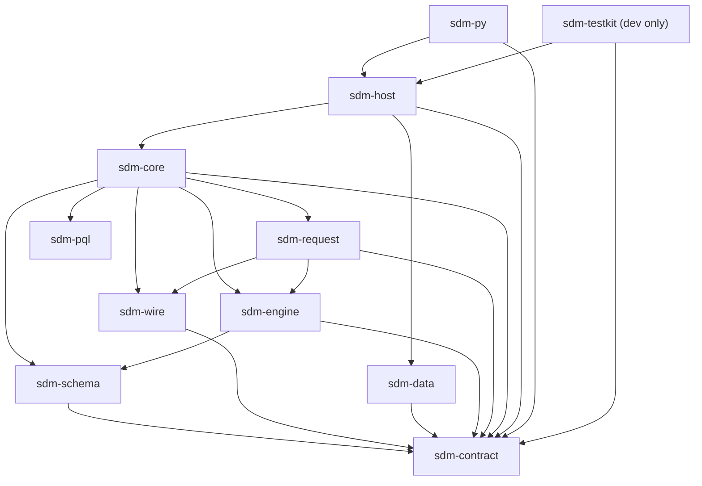

# The Rust core

One Rust library that every host language shares.
A host (Python today) starts an operation, and the core answers with steps: run these SQL statements, send this request body to the model, or here is the result.
The host runs each step with its own database driver or HTTP client and hands back Arrow tables or response bytes.
The core opens no database connection and no network socket.
Time zones come from directories the host names, then from a bundled copy.

## Crates

The last column is what `scripts/rust_core/l0_deps.py` allows, for any kind of dependency, test ones included; the diagram below shows what is used.

| Crate | Purpose | May depend on |
|---|---|---|
| `sdm-contract` | The versioned messages and types between the core and its hosts; no logic, no I/O | nothing |
| `sdm-pql` | The PQL lexer, parser and validators | nothing |
| `sdm-wire` | The model API's JSON: the payload and the response | `sdm-contract` |
| `sdm-schema` | Schema inference over Arrow, assembly and edits (the schema's types are `sdm-contract`'s) | `sdm-contract` |
| `sdm-data` | The data layer: SQL for each dialect (DuckDB, SQLite, Postgres) and reading the answers | `sdm-contract` |
| `sdm-engine` | Time and zones, random streams, sampling rules, labels | `sdm-schema`, `sdm-contract` |
| `sdm-request` | The model request's payload and options, the ranking and the result layout | `sdm-engine`, `sdm-schema`, `sdm-wire`, `sdm-contract` |
| `sdm-core` | The run state machine and the operations: describe, edit, validate, materialize, predict | every crate above |
| `sdm-host` | The layer every binding shares: message codec, Arrow admission, run ownership, panic containment, zones | `sdm-core`, `sdm-data`, `sdm-contract` |
| `sdm-py` (in `bindings/`) | The Python module `sdm_client._native` | exactly `sdm-host` and `sdm-contract` |
| `sdm-testkit` (dev only) | A pure-Rust test host and the `sdm-contract-run` program for the contract cases | `sdm-host`, `sdm-contract` |

A Java binding, `sdm-jni`, is planned under `bindings/` with the same rule as `sdm-py`.

## Dependency diagram

The normal (non-test) dependencies in use today.
Shipped `sdm-core` code reaches the data layer only through the `DataLayer` trait in `sdm-contract`, and `sdm-host` plugs `sdm-data` in.
`sdm-engine` depends on `sdm-schema` only to implement its `infer::TextTimes` trait, which is how inference reads text as times.
Test-only dependencies, not drawn: `sdm-core`'s tests use `sdm-data`, and the tests of `sdm-host` and `sdm-testkit` use `test-ops` builds of `sdm-core` and `sdm-host`.
Each crate's own README repeats its part of this graph.



The same graph in plain text (each crate also depends on `sdm-contract`, except `sdm-pql`):

```text
sdm-py ----------+
sdm-testkit -----+--> sdm-host --+--> sdm-core --+--> sdm-request --+--> sdm-wire
                                 |               |                  +--> sdm-engine --> sdm-schema
                                 |               +--> sdm-engine
                                 |               +--> sdm-schema
                                 |               +--> sdm-wire
                                 |               +--> sdm-pql
                                 +--> sdm-data

sdm-contract: the leaf every crate but sdm-pql shares
sdm-pql: depends on no crate of ours
```

## Rules the boundaries enforce

- Only `sdm-data` writes SQL or knows a dialect; `sdm-schema`, `sdm-engine`, `sdm-request` and `sdm-core` hold neither.
- The Python providers in `sdm_client/_rust/providers/` write no SQL either; they run what `sdm-data` rendered.
- `sdm-pql` depends on no crate of ours, and only `sdm-core` depends on it, through `sdm-core/src/pql.rs` (and the test-only `test_ops.rs`).
- `sdm-contract` depends on no crate of ours and does no I/O; a change of its message shapes bumps the contract version, and `sdm-contract/schema/contract.lock` holds the shapes.
- No shipped crate links a database driver, and only a binding links a language runtime, its own (`pyo3` for `sdm-py`).
- A binding depends on exactly `sdm-host` and `sdm-contract`, never on `sdm-core` directly.
- No shipped crate depends on `sdm-testkit`.
- Unsafe code is forbidden in every shipped library crate (all of `crates/` but `sdm-testkit`), and denied in `sdm-py` and `sdm-testkit`.
- Copying a Python library's incidental behavior (a codec, a repr) is confined to three `sdm-pql` modules, named in `scripts/rust_core/emulation-allowlist.txt`: Python's integer digit limit, its float text, and its string escapes.
  Porting an algorithm the Python code defines (random streams, seed hashes, date offsets) is allowed in the crate that owns it.

`scripts/rust_core/l0_deps.py` checks the crate graph and `scripts/rust_core/l0_scan.py` checks the SQL, dialect and Python-behavior rules.

## Building and testing

The workspace is this folder: `cargo test --workspace` runs the Rust tests.
The `test-ops` feature adds operations that only tests reach; shipped builds leave it off.
The Python wheel is built from `bindings/sdm-py` with maturin; [`CONTRIBUTING.md`](../CONTRIBUTING.md) has the commands.
